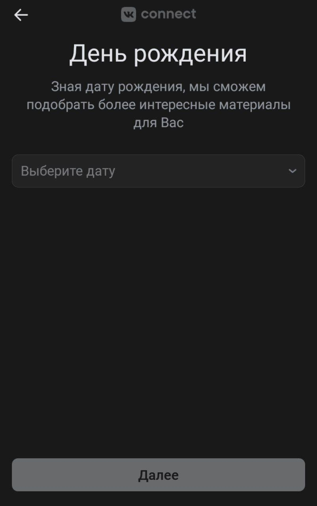

# Прямая авторизация
Прямая авторизация — это авторизация по логину и паролю. Такой тип авторизации доступен маленькому кругу приложений, чаще всего это официальные приложения ВКонтакте.

При использовании прямой авторизации вы можете получить токен с полным доступом к аккаунту.

## Что делать?
Для начала вам нужно выбрать приложение, которое вы будете использовать. *Я рекомендую использовать Android*

| ID приложения | Секретный ключ       | Описание      |
|---------------|----------------------|---------------|
| 2274003       | hHbZxrka2uZ6jB1inYsH | Android       |
| 3682744       | mY6CDUswIVdJLCD3j15n | iPad          |
| 3140623       | VeWdmVclDCtn6ihuP1nt | iPhone        |
| 2685278       | lxhD8OD7dMsqtXIm5IUY | Kate Mobile   |
| 3469984       | kc8eckM3jrRj8mHWl9zQ | Lynt          |
| 5027722       | Skg1Tn1r2qEbbZIAJMx3 | VK Messenger  |
| 2037484       | gpfDXet2gdGTsvOs7MbL | Nokia         |
| 4580399       | wYavpq94flrP3ERHO4qQ | Snapster      |
| 3032107       | NOmHf1JNKONiIG5zPJUu | Vika          |
| 3697615       | AlVXZFMUqyrnABp8ncuU | Windows 10    |
| 3502557       | PEObAuQi6KloPM4T30DV | Windows Phone |
| 3265802       | t106ZcWMk9BLdrxobdh5 | API Console   |
| 3032107       | NOmHf1JNKONiIG5zPJUu | BlackBerry    |

Далее составьте запрос к `https://oauth.vk.com/token` с этими параметрами:
* `scope = all`
* `client_id` — ID выбранного приложения
* `client_secret` — секретный ключ выбранного приложения
* `username` — логин
* `password` — пароль
* `2fa_supported` — `1`, если вы готовы обрабатывать 2FA
* `grant_type = password`
* `lang = ru`
* `v = 5.130`
* `trusted_hash` — если у вас есть `trusted_hash`, то указывайте. Этот параметр нужен для пропуска 2FA

Итоговый URL: `https://oauth.vk.com/token?scope=all&client_id=2274003&client_secret=hHbZxrka2uZ6jB1inYsH&username=88005553535&password=qwerty123456&2fa_supported=1&grant_type=password&lang=ru&v=5.130`

Если у вас отключена 2FA, то на этом этапе вы уже получите свой `access_token`.

### 2FA
Если у вас настроена двухфакторная аутентификация, то вам будет необходимо пройти еще одну проверку.

Сервер авторизации VK вернёт примерно такой JSON:

```json
{
  "error": "need_validation",
  "error_description": "use app code",
  "validation_type": "2fa_app",
  "validation_sid": "2fa_305360617_2274003_somehash",
  "phone_mask": "+7 *** *** ** 11",
  "redirect_uri": "https://m.vk.com/login?act=authcheck&api_hash="
}
```

#### Редирект
Вы можете перенаправить пользователя на `redirect_uri`, где он должен будет ввести код. После успешной авторизации будет произведен редирект на страницу `https://oauth.vk.com/blank.html#success=1&access_token=&user_id=123`.

Если вам не нравится способ с редиректом, то вы должны просто переотправить запрос, добавив параметр `code` с кодом подтверждения.

#### Получение кода подтверждения на телефон
Вы можете отправить код подтверждения на номер телефона. Для этого используйте метод `auth.validatePhone`, передав следующие параметры:
* `client_id` — ID приложения для авторизации. Используйте то же значение, что и при отправке запроса
* `client_secret` — ID приложения для авторизации. Используйте то же значение, что и при отправке запроса
* `api_id` — то же самое, что и `client_id`
* `sid` — `validation_sid` от oauth-сервера

После этого на привязанный к странице номер телефона придёт SMS с кодом подтверждения.

## Обработка капчи
Сервер может вернуть ответ, где будет `error = need_captcha`. В этом случае вы должны показать пользователю капчу. Ссылку на изображение можно получить так: `https://api.vk.com/captcha.php?sid={result.captcha_sid}&s=1`

После этого нужно еще раз отправить запрос к oauth-серверу, добавив эти параметры:
* `captcha_sid` — `captcha_sid` из ответа oauth-сервера
* `captcha_key` — текст с капчи

## Аккаунт заблокирован
Если ваш аккаунт заблокирован, то сервер вернет ошибку, где будет поле `ban_info`.

## trusted_hash
Если вы успешно авторизовались с 2FA, то в ответе сервера будет поле `trusted_hash`. Значение этого поля можно использовать в дальнейшем для пропуска двухфакторной аутентификации (вам не нужно будет вводить код).


## Особенности авторизации с версии API 5.123
С вводом VK Connect, если в аккаунте не хватает каких-либо данных, API отдаст ошибку, формат ответа будет подобно следующему:
```json5
{
  "extend_fields": [
    "birthday"
  ],
  "sid": "c55e62..."
}
```
`birthday` - в профиле не хватает данных о дне рождении.
> TODO: что делать с sid?

В то же самое время, в приложении это выглядит так:
<div style="max-width: 300px">

</div>
